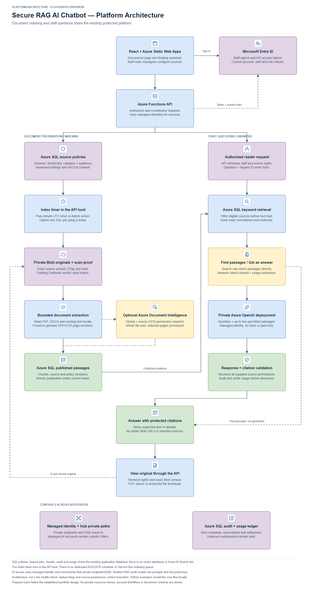

# Secure RAG AI Chatbot

[](docs/diagrams/architecture.svg)

[View SVG](docs/diagrams/architecture.svg) · [Download PNG](docs/diagrams/architecture.png) · [Edit in draw.io](docs/diagrams/architecture.drawio)

**Find information in the documents a staff member may read, then optionally explain it with cited AI answers.**

[The problem](#the-business-problem) · [The solution](#the-solution) · [What was built](#what-was-built) · [Proof it works](#proof-it-works) · [Commands](docs/COMMANDS.md) · [Step by step](#step-by-step)

## The Business Problem

Staff need quick answers from current instructions, but a general-purpose
chatbot may answer from the wrong version or expose restricted information.
Searching every employee document also turns a convenience feature into an
access-control risk. This project narrows answers to explicitly approved
documents, keeps General and Restricted audiences separate and refuses to
invent an answer when permitted evidence is missing.

## The Solution

Build three separate paths: prepare approved text, retrieve passages the
current reader may access, and optionally ask an Azure-hosted model to explain
those passages with citations. Recheck source versions and access after the
model returns; source text is evidence, never a new set of instructions or a
reason to bypass an employee's permissions.


**Business outcome:** Help staff find permitted instructions and explain them with cited answers, without treating every document as available to every reader.

## Tools Used and What They Do

| Tool or service | What it does | Where it fits |
| --- | --- | --- |
| Python | Index documents and coordinate answers | Local command-line client |
| SQLite | Store sources, passages and usage | Local keyword index and ledger |
| Azure OpenAI | Explain permitted evidence with citations | Optional answer adapter |
| Entra ID / Azure Identity | Obtain an Azure service token | Optional Azure caller; hosted user validation is separate |
| Document Intelligence OCR | Supply approved page text for scans | Optional import from the OCR project |
| Terraform / GitHub Actions | Describe resources and run checks | Infrastructure example and manual tests |

## Step by Step

[Open the standalone build guide](docs/BUILD-YOUR-OWN.md) or follow the same instructions below.

### Prerequisites

Use Python 3.11 or newer and your own fictional test files. Azure and external AI are optional; live examples require your own approved account, network path and reviewed processing costs.

Commands run from your new project root; use PowerShell for the shown environment-variable syntax. Follow the named source files as implementation references without needing to clone a portfolio repository.


### Step 1 — Create the project structure

Create a folder named `secure-rag-ai-chatbot` with `rag_project`,
`examples`, `tests` and `docs` subfolders. Use the accompanying files as
implementation references to build each component below, without needing
to clone an existing repository.

```powershell
mkdir secure-rag-ai-chatbot
cd secure-rag-ai-chatbot
python -m venv .venv
```

Commands below run from that folder after placing the accompanying files in
their indicated paths. On Windows use `.venv\Scripts\python`; on Linux/macOS
substitute `.venv/bin/python`.

### Step 2 — Define audiences before indexing documents

Define a tenant, source ID, title, classification, explicit staff audience and
separate AI/OCR permissions for each document. General means the listed staff
roles, not public internet access; this example allows Restricted sources only
for explicitly selected Admin, HR or Payroll roles.

```json
{
  "tenant": "fictional",
  "id": "attendance-instructions",
  "title": "Attendance instructions",
  "file": "general.txt",
  "classification": "General",
  "roles": ["Admin", "HR", "Payroll", "Supervisor", "Caregiver"],
  "ai_allowed": true,
  "ocr_allowed": false,
  "reviewed_sha256": "REPLACE_WITH_EXACT_FILE_SHA256"
}
```

Save this as a manifest next to the referenced file. Paths are resolved relative
to that manifest; the operator must review the exact source and its safety.

### Step 3 — Prepare original text or approved OCR output

Read UTF-8 TXT/Markdown locally and preserve the exact original hash, or import
page-numbered JSON from the separate Azure OCR project with OCR permission On.
Do not invent page numbers for a plain-text file, pass a fictional fixture as
real OCR evidence or automatically send unreadable files to a paid service.

```powershell
.venv\Scripts\python -m rag_project --db work/import-example/library.db index examples/manifest.json --reviewed-input
# For an actual approved scanned PDF with matching genuine OCR JSON:
.venv\Scripts\python -m rag_project --db work/ocr-example/library.db index examples/scan-manifest.json --ocr-result work/ocr-pages.json --reviewed-input
```

The included `examples/manifest.json` matches the fictional text file. Create
`examples/scan-manifest.json` separately with your own approved PDF and reviewed hash. The import examples use separate databases, so they do not leave
a duplicate source in the walkthrough demo database. Native PDF/DOCX parsers
are outside this implementation; add and test them separately when required.

### Step 4 — Publish a complete source revision

Split text into whole-word chunks of at most 1,200 characters with up to 30
words of overlap, and store normalized terms alongside source provenance.
Commit the new source and all chunks atomically so a failed extraction cannot
leave a partially published replacement.

```powershell
.venv\Scripts\python -m rag_project --db work/demo/library.db demo
```

This creates two fictional sources without any Azure call. The chunking and
128-codepoint term rules count Python Unicode characters. Revalidate these
limits when adding other parsers or changing the indexing strategy.

Rerunning `demo` deliberately restores its two fictional sources and advances
their revisions. Run it only in the dedicated demo database; repeat it before
restarting the walkthrough after the withdrawal step.

### Step 5 — Retrieve evidence before asking AI

Filter by tenant, active source and permitted role, rank local term metadata,
then validate the selected originals before loading at most five passage texts.
Recheck every selected source again immediately before returning search results. Return no
evidence for unrelated questions rather than confusing a search match with
proof that an answer is correct.

```powershell
.venv\Scripts\python -m rag_project --db work/demo/library.db search "attendance" --role Caregiver
.venv\Scripts\python -m rag_project --db work/demo/library.db search "restricted" --role Caregiver
.venv\Scripts\python -m rag_project --db work/demo/library.db search "restricted" --role Admin
```

The Caregiver restricted search returns `[]`, while Admin can see the permitted
fictional passage. `--role` simulates a trusted caller for the local exercise;
**it is not Entra sign-in and must never become a client-selected web role**.

### Step 6 — Prepare keyless Azure generation

Prepare an Azure OpenAI account and a chat-compatible model deployment with
JSON mode, then give the intended caller the account-scoped `Cognitive Services
OpenAI User` role. Verify the region, private DNS/path, model compatibility and
current price before setting an explicit conservative answer estimate.

```powershell
.venv\Scripts\python -m pip install -r requirements-azure.txt
az login
$env:AZURE_OPENAI_ENDPOINT = 'https://YOUR-RESOURCE.openai.azure.com'
$env:AZURE_OPENAI_DEPLOYMENT = 'YOUR-CHAT-DEPLOYMENT'
$env:ANSWER_ESTIMATE_MICRO = '10000' # Example $0.01 hold, not a current quote.
$env:ALLOW_AZURE_CALLS = 'yes'
```

### Step 7 — Generate and validate one grounded answer

Send only the question and permitted passages, with an instruction to treat
document text as untrusted evidence and cite supplied IDs. Reject malformed,
uncited or foreign-citation answers and recheck every supplied source before
disclosure, including passages the model did not cite.

```powershell
.venv\Scripts\python -m rag_project --db work/demo/library.db answer "What should I do about a missed clock event?" --role Caregiver --request-id YOUR-UUID
```

This operator-run example was not executed against Azure for the project.
Citation validation proves referenced IDs were supplied, not that every model
sentence is factually entailed; human review and relevance evaluation remain necessary.

### Step 8 — Prove revocation, denial and uncertainty

Withdraw a fictional source and confirm new searches omit it, then run tests
that change or withdraw evidence while a mocked model is responding. Keep the
old usage/audit records and hold uncertain paid work instead of creating a new
request ID to bypass it.

```powershell
.venv\Scripts\python -m rag_project --db work/demo/library.db withdraw general
.venv\Scripts\python -m rag_project --db work/demo/library.db search "attendance" --role Caregiver
.venv\Scripts\python -m unittest discover -s tests -v
```

After withdrawing `general`, the attendance search in this dedicated demo
database returns `[]`. The separate import-example database is unaffected.

### Step 9 — Plan the hosted identity boundary separately

Before exposing an API, validate Entra access-token signature, issuer, audience,
expiry, tenant and current staff/role state server-side and derive the principal
there. Replace local file paths/CLI authority with protected Blob/version reads,
real scan proofs, category/person rules and an authoritative policy store, then
test genuine lower-role denials and private paths in an isolated environment.

## Architecture

[View the illustrated architecture](docs/diagrams/architecture.svg) · [Edit in draw.io](docs/diagrams/architecture.drawio)

The diagram shows the platform architecture: Azure Static Web Apps and Entra sign-in,
the Azure Functions API, private Blob originals, Defender-backed scan proofs,
and Azure SQL policies, leased jobs, passages, usage and audit. Document Intelligence
reads scanned text; Azure OpenAI separately generates answers from permitted passages.

[Read the platform component map](docs/PLATFORM-ARCHITECTURE.md). The runnable Python
examples model the core rules locally with SQLite; the diagram does not claim
that running the examples commissions those hosted components.

## What Was Built

- A Python local CLI, fictional General/Restricted instructions and a SQLite
  source/chunk index with atomic revision publication and withdrawal.
- Unicode-normalized whole-word keyword retrieval, bounded overlapping chunks,
  top-five evidence selection and source-hash checks before disclosure.
- An optional Azure chat-completions adapter with cited JSON answers, abstention,
  durable usage holds and no automatic paid retries.
- Explicit OCR-result import from the companion project, tests, Terraform
  preparation and build instructions for adapting the design to a real service.

This implementation uses **keyword retrieval**, not embeddings or a vector
database. Adding vectors is a future design choice; RAG means retrieving
evidence before generation and does not require a vector service.

## Proof It Works

Offline tests exercise tenant/role separation, changed-source rejection,
revision invalidation, withdrawal during generation, all-context rechecks,
invalid citations, no-evidence abstention and durable paid-request admission.
The local demo/search commands provide reproducible evidence without a model;
mocked adapter tests verify request construction but do not establish live Azure
compatibility, production security certification or a deployed service.

See [validation](docs/validation.md) and [access matrix](docs/access-matrix.md).

## Access boundaries and limitations

Admin does not receive an implicit bypass: its role must appear in the source
audience. The local OCR JSON method marker is a provenance label, not a cryptographic
provider attestation. A trusted operator supplies it here; a hosted importer
must verify its own recorded operation receipt and output lineage instead of
trusting a client-supplied JSON label.

This simplified example has no employee-only/caseload permissions,
source expiry, document-category roles or dynamic directory refresh.
Person-level and category-level policies require additional server-side checks.

The local retriever visits permitted source/chunk term metadata and ranks
whole-word overlap, so it misses synonyms and can be slow on a large library. It is not
SQL full-text search, BM25, hybrid search, semantic ranking or an answer-confidence
percentage. Prompt-injection instructions are reduced to data and no tools are
offered, but this is a mitigation, not a guarantee against all model behavior.

Access rechecks cannot retract passages already processed by the provider or
bytes a reader previously downloaded. A hosted service must address current-role
refresh, concurrent policy updates, request cancellation and disclosure timing;
the trusted local CLI is not proof of instant distributed revocation.

## Implemented bounds

| Item | Local limit |
| --- | --- |
| Original bytes | 10 MiB per actual file read |
| Native extraction | UTF-8 TXT/Markdown; no invented page numbers |
| Imported OCR | Schema 1; 1–50 distinct numbered pages, exact source hash |
| Extracted text | 1,000,000 characters per document |
| Published index | 1,000 chunks per source; 1,000 sources/10,000 chunks per tenant |
| Question/evidence | 1–1,000 characters; at most five passages |
| Answer | 500 requested output tokens; at most 5,000 returned characters |

These are application ceilings, not measured production capacity or a model
compatibility guarantee. The model output-token setting requires a deployment
that supports this chat-completions contract.

## Azure references

- [Azure OpenAI v1 API and Entra authentication](https://learn.microsoft.com/en-us/azure/foundry/openai/api-version-lifecycle)
- [RAG design concepts](https://learn.microsoft.com/en-us/azure/search/retrieval-augmented-generation-overview)
- [Azure Identity for Python](https://learn.microsoft.com/en-us/python/api/overview/azure/identity-readme)

The adapter uses Azure's `/openai/v1/chat/completions` contract with a configured
deployment; it does not train a model or use the ChatGPT website.

## Reject empty replacements deliberately

An extraction with no searchable terms does not replace the saved index revision.
Review blank scans, encoding and unusually long tokens instead of interpreting
an empty index as successful document coverage. If the original bytes already
changed, the previous revision remains blocked until the reviewed original is
restored or useful new extraction is indexed; preservation is not permission
to return stale evidence.

## Input errors and identity keys

Native TXT/Markdown must be valid UTF-8. Invalid encoding stops indexing before
the saved revision changes; if the original file was replaced, retrieval still
blocks its old index until the reviewed original is restored or reindexed.
An invalid-Unicode model answer is withheld and its paid request remains held;
it is not recorded as a successful answer or automatically retried.

## Runtime and access boundaries

The Python example runs as a **trusted local operator CLI** with SQLite, not as a
hosted multi-user service. CLI role/actor arguments, local files and SQLite are
operator-controlled; they must never be accepted as proof of identity from a
web request. There is no login endpoint, Entra JWT validation, malware scanner,
private Blob reader, production queue lease, encryption wrapper, UI or managed
service deployment wired into this sample. Azure adapters are prepared and
mock-tested, not exercised against live services in this review.

## Security Practices

Use fictional material first. A matching SHA-256 binds a review to exact bytes;
it is not a malware verdict or evidence that the document is safe. A production
intake must verify a genuine Defender clean result tied to the exact Blob version,
protect the original and obtain processing/audience permission before this code
is called. The local JSON manifests/results and SQLite files may contain private
text; keep them on access-controlled encrypted storage and outside Git.

Azure authentication uses `DefaultAzureCredential` only when live mode is
explicitly selected. Use a dedicated managed identity in a hosted deployment,
disable local-key authentication, scope the service data role to its account,
and verify DNS/private networking before sending files or passages. A private
endpoint alone is insufficient without working DNS and a private caller path.

Routine ledger audit stores request IDs, times and fixed outcomes, not raw
questions/answers or token values. A content fingerprint is still metadata that
needs access protection. Neither `store=false`, Azure hosting nor encryption
alone establishes HIPAA/SOC 2 compliance or guarantees zero provider retention;
review applicable service terms, geography and organizational obligations.

## Costs and Safe Restart

Local tests and fictional demos make no cloud requests. The optional Azure path
can incur processing, private-endpoint, DNS, storage and log charges; no resource
is created by running the Python demo. The Terraform example is preparation,
not an instruction to apply it to an existing production environment.

The default local processing allowance is $3 per UTC month per ledger, expressed
as 3,000,000 microdollars. This admission limit is separate from infrastructure costs and is not an Azure
invoice cutoff. Use a reviewed conservative
per-operation estimate; completed work retains that estimate rather than
claiming actual token/page reconciliation. Underestimates, separate ledgers,
shared resources, reporting lag and infrastructure charges can exceed that plan.

Admission uses an atomic SQLite transaction: one reserved/unknown paid request
at a time **per ledger** and 20 reservations per actor per UTC day. Not-sent work frees its
processing estimate but still counts toward the daily limit. A timeout after
submission is unknown and continues to block work, including across month
boundaries. An unknown record cannot be changed to `not_sent`, saved operation receipts
cannot be replaced, and completed results are immutable. Reconcile provider
status and billing before an operator repairs an unknown hold; there is deliberately no automatic clear/retry command.

Never delete the ledger simply to bypass a hold. Back up its exact state along
with originals, policies and index versions; a successful database restore
alone does not prove application failover or absence of duplicate paid work.

The two independent projects use separate ledgers unless deliberately
configured otherwise; their allowances and concurrency slots are not a single
shared Azure budget. A fresh UUID after a completed request represents new
paid work, so duplicate-ID protection is not content-based deduplication.

## Troubleshooting Lessons

- **Service or private path unavailable:** inspect resource state, endpoint/DNS,
  credentials and scoped access before changing the file or paying for a retry.
- **403 despite successful sign-in:** a token proves identity, not the required
  service permission; verify the correct principal, tenant, audience and role scope.
- **Result unknown after a timeout:** preserve the request ID and ledger; do not
  create a fresh paid operation merely because the browser/CLI stopped waiting.
- **File changed:** original bytes, review hash and derived text must agree;
  update the review and index deliberately instead of relabeling old evidence.

## Scaling and Tradeoffs

SQLite and local files keep this exercise easy to inspect but are not a
distributed coordination/security boundary. Measure queue wait, scan delay,
page/text size, token usage, denial rates and paid-operation uncertainty before
moving to Azure SQL jobs with leases and atomic publication. Add bounded worker
concurrency only after shared admission, provider quota and idempotency are
proven across instances; otherwise retries can multiply spend and stale results.

Keep ingestion, retrieval and generation independently switchable. A production
rollout also needs genuine scan integration, verified current staff/tenant
claims, protected Blob versions, content-free operational logs, CI dependency
and secret scans, restore rehearsal and measured relevance/accuracy checks.
Private paths and new search tiers introduce standing costs even with no users.

## Boundary with the other projects

OCR schema-1 UTF-8 output is compatible with this CLI's bounded JSON importer
when its exact source hash and explicit processing/audience policy match. Plain
search rechecks selected evidence before disclosure; it does not fail solely
because a nonmatching document's original is unavailable. A matching unavailable
or changed source still blocks its result, and these checks cannot recall earlier
disclosure or promise zero-latency distributed revocation.

Email quarantine acceptance does not authorize indexing or AI use, and a badge
source/portrait is not automatically a RAG document. This package does not connect
those repositories, import a mailbox automatically or turn job titles into roles.

## Project Guides

- [Build your own](docs/BUILD-YOUR-OWN.md)
- [Commands](docs/COMMANDS.md)
- [Validation and evidence limits](docs/validation.md)
- [Editable architecture](docs/diagrams/architecture.drawio)

## Cost and Cleanup

Local fixture tests do not call paid providers. Keep optional live settings Off until configured, review infrastructure and processing charges, and retire only resources owned by your lab.

Preserve source files, issued history, revocations and uncertain-request receipts when cleaning up. Do not delete ledgers to bypass holds or run blanket cleanup against a shared environment.

## Related Projects

- [Document OCR with Python](https://github.com/truthofsource/azure-document-ocr-python)
- [Email document ingestion with Python](https://github.com/truthofsource/azure-document-ingestion-python)
- [AI-Assisted Employee Badge Generation](https://github.com/truthofsource/employee-badge-generation-python)

Publishing this code does not start a service, approve a document or enable paid processing.
